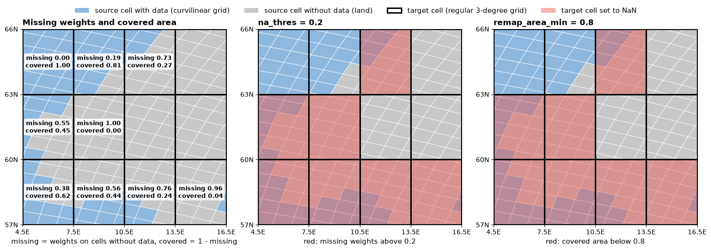

Masking: ``na_thres`` and ``remap_area_min``
============================================

Regridding is a weighted average: each target cell takes the values of the source cells that overlap it.
When some of these source cells are missing (NaN, typically land in ocean data) the average rests on fewer
points, and may stop being representative. smmregrid has two thresholds to set NaN in such target cells,
``na_thres`` and ``remap_area_min``. For conservative remapping with the default normalization they are the same
check written in two ways, and ``na_thres`` is the more general of the two. ``remap_area_min`` is a CDO feature, kept
for compatibility with it. How the missing values enter the weights (``mask_dim``, ``skipna``) is described in
:doc:`regridder`.

The two numbers of a target cell
--------------------------------

For every target cell there are two numbers, both between 0 and 1:

* **missing weights**: the share of the weights of the cell that belongs to missing source cells. Only the
  source cells that overlap the target cell count.
* **covered area**: the fraction of the target cell covered by valid source cells, the quantity that CDO computes for
  conservative remapping. With the default normalization (``fracarea``) the weights are normalized by the part of the
  target cell that the source grid covers, so the covered area is *relative to that part*: it is one minus the missing
  weights. With ``destarea`` the weights are divided by the whole area of the target cell and the covered area is
  *absolute*: a part of the target cell outside the source grid counts as not covered.

The figure shows a real case: an ocean model on a curvilinear grid (IPSL, blue and grey, the cells are tilted along the coast
of Norway) regridded to a regular 3-degree grid (black squares) with ``skipna=True``. The source cells do not line up with
the target cells, and each target cell overlaps several of them, some with data (ocean) and some without (land).

The left panel gives the two numbers of each target cell. In the open sea nothing is missing and the covered area is 1.
Where the cell is partly on land they sum to 1: the cell at the top with 0.81 covered has 0.19 of its weights missing.
The two other panels apply a threshold on each number. ``na_thres=0.2`` masks the cells with more than 20% of the weights
missing, ``remap_area_min=0.8`` the cells with less than 80% covered: they are the same cells (red). The cell at 0.81 is kept
by both, just above the threshold, and all the others except the fully valid one are masked.

At the edge of a regional source grid, with ``fracarea`` the part of the target cell outside the source grid is ignored: a
cell covered by the source only in part, and all valid, has nothing missing and a covered area of 1, and both thresholds keep
it. With ``destarea`` the covered area would be the covered part of the cell, and only ``remap_area_min`` would mask it.

``na_thres``
------------

``na_thres`` is the *maximum fraction of missing weights*: a target cell is set to NaN when the share of its
weights coming from missing source cells is larger than ``na_thres``. It is a number between 0 and 1: with 0 a single
missing source cell is enough to mask the target cell, with 1 a target cell is masked only when no valid source
cell contributes.

* It is used with all methods.
* With ``skipna=True`` it is evaluated at each call, on the missing values of the data.
  The default ``"auto"`` gives ``1e-6`` for ``bil`` and ``bic`` (a missing neighbour makes the target cell NaN, as in CDO)
  and ``1.0`` for the other methods, i.e. no masking by ``na_thres``.
* Without ``skipna`` (with a fixed mask or with ``mask_dim``) the weights are generated with the mask of the data, so the
  missing source cells have no weight and every target cell that has weights is made of valid cells only. ``na_thres`` is
  then not a threshold: any value below 1 masks the target cells without any valid source cell, and ``1.0`` does not mask them
  (they get 0). The default ``"auto"`` gives ``0.5``.

``remap_area_min``
------------------

``remap_area_min`` is the *minimum covered area* of the target cell: a target cell is set to NaN when the
fraction of it covered by valid source cells is smaller than ``remap_area_min``. The default is ``0.5``.
It is the CDO option with the same name, and CDO uses it for conservative remapping only: it is the only method for which
CDO computes a covered fraction different from 0 and 1. For the other methods it has no effect.

With and without ``skipna`` the result is the same, as in CDO (without it the covered area of each target cell comes from CDO,
with the mask of the data).

Why they are the same for conservative remapping and not for bilinear
----------------------------------------------------------------------

This comes from what CDO computes, not from smmregrid. In conservative remapping the weight of a source cell is the area
where it overlaps the target cell, so the weights are pieces of the target cell, and "weights on missing source cells" and
"area of the target cell on missing source cells" are the same quantity seen from the two sides. For example, a target
cell overlaps four source cells, with 0.4, 0.3, 0.2 and 0.1 of the cell, and the last two are land. The missing weights are
0.2 + 0.1 = 0.3 (what ``na_thres`` looks at) and the covered area is 0.4 + 0.3 = 0.7 (what ``remap_area_min`` looks at):
0.7 = 1 - 0.3. So ``na_thres = 1 - remap_area_min`` selects the same cells: it is the same threshold on the same number (the
figure shows it, ``na_thres=0.2`` and ``remap_area_min=0.8`` mask the same cells).

This holds when the weights sum to the area of the target cell that the source grid covers, as with ``fracarea``. It is a
convention of CDO: with ``fracarea`` a part of the target cell outside the source grid is ignored, while with ``destarea``
the covered area is relative to the whole cell, and the two thresholds differ at the edge of the source grid.

For interpolation methods the weights are not areas but coefficients between points, and CDO has no covered area: its
fraction is 0 or 1. With ``bil`` the weights of a target cell are spread on several source cells and a share of them can be
missing, which only ``na_thres`` looks at; ``remap_area_min`` does nothing. With ``nn`` there is a single weight, so the
share is 0 or 1 and neither threshold changes the result.

=======================  ==============================================================================
method                   ``na_thres = 1 - t`` against ``remap_area_min = t``
=======================  ==============================================================================
``con``, ``fracarea``    same cells (up to floating-point ties at exactly ``t = 0.5``)
``con``, ``destarea``    different: absolute covered area against relative share of the weights
``bil``, ``bic``         only ``na_thres`` masks cells, ``remap_area_min`` has no effect
``nn``                   neither masks anything: the share of valid weights is 0 or 1
=======================  ==============================================================================

In practice ``remap_area_min`` could be absorbed by ``na_thres``: for conservative remapping with ``fracarea`` it is
``na_thres = 1 - remap_area_min``. smmregrid keeps both because ``remap_area_min`` is the name of the CDO option,
and because its default (0.5) is what masks the coastal cells, while the default of ``na_thres`` for ``con`` does not mask
anything.

Examples
--------

.. code-block:: python

    # conservative, mask the target cells with less than 80% of their area covered by valid source cells
    regridder = Regridder(source_grid, target_grid, method='con', skipna=True, remap_area_min=0.8)

    # the same, with na_thres: set to NaN the target cells with more than 20% of the weights on missing source cells
    regridder = Regridder(source_grid, target_grid, method='con', skipna=True, na_thres=0.2, remap_area_min=0.0)

    # bilinear: set to NaN the target cells with more than 30% of the weights on missing source cells
    regridder = Regridder(source_grid, target_grid, method='bil', skipna=True, na_thres=0.3)

In the code the two masks are applied by two small functions of ``smmregrid.weights``, ``mask_na_thres`` and
``mask_area_min``. They are used by ``Regridder.tensordot`` (with ``skipna``, and for ``remap_area_min`` also without it)
and by ``mask_weights`` to build the target mask when ``skipna`` is not used.
